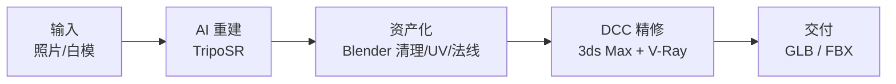
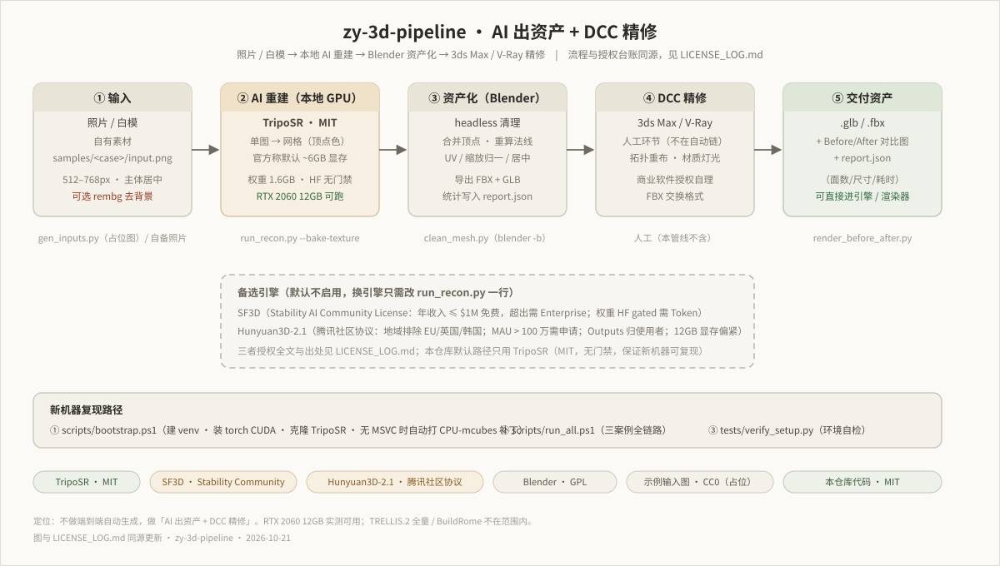

# zy-3d-pipeline

**本地 3D 资产生成管线**：照片 / 白模 → AI 三维重建 → Blender 资产化 → 3ds Max + V-Ray 精修。

定位说明：本管线**不做端到端自动生成**。AI 负责把一张图变成可编辑的网格资产，
拓扑清理、UV、法线、材质与最终渲染交给 DCC 工具精修——AI 出资产，人做精修。





---

## 1. 环境要求

| 项目 | 要求 | 本机实测（2026-10-21） |
|---|---|---|
| 显卡 | NVIDIA，显存 ≥ 10GB | RTX 2060 12GB，驱动 610.88 |
| CUDA | ≥ 12.6（torch cu126 轮子） | ✅ |
| Python | ≥ 3.10 | 3.12.14 |
| Blender | ≥ 4.2 LTS（脚本用 `blender -b --python` 无头运行） | 4.5.3 LTS |
| 磁盘 | 约 12GB 空闲（torch 2.7G + 权重 1.6G + 依赖） | C: 308GB 空闲 |

> **显存红线**：12GB 跑不动 TRELLIS.2 全量与 BuildRome，本管线只用
> **TripoSR**（默认）/ SF3D / Hunyuan3D-2.1 三档。
> TripoSR 默认参数（256³）本机实测峰值显存 **1.82GB**——官方 README 称约 6GB 是保守值，
> 实际远低于此；512³ 分辨率未实测（按激活显存估算约 4 倍，12GB 有 OOM 风险，属推断未验证）。

## 2. 安装

### 一键（推荐，Windows PowerShell）

```powershell
powershell -ExecutionPolicy Bypass -File scripts\bootstrap.ps1
```

脚本依次完成：建 venv → **装 CUDA 版 torch**（约 2.7GB）→ 装其余依赖 →
装 torchmcubes CPU shim → 拉取 TripoSR 源码并打补丁（见 §7）→ 自检
（`python tests/verify_setup.py`）。

可选环境变量：`PIP_INDEX`（PyPI 镜像，默认阿里云；海外设 `https://pypi.org/simple`）、
`TORCH_CUDA`（默认 `cu126`，需驱动 ≥525；老驱动设 `cu121`）、`BLENDER_BIN`。

### 手动（或非 Windows）

```bash
# 1. venv
python -m venv .venv && .venv/Scripts/python -m pip install -r requirements.txt

# 2. torch 必须单独先装（PyPI/镜像源的 Windows torch 是 CPU 构建，
#    先装 requirements 会被误判“已满足”而跳过，GPU 直接不可用）
pip install torch torchvision --index-url https://download.pytorch.org/whl/cu126

# 3. torchmcubes CPU shim（见 §7）
pip install ./third_party/torchmcubes-cpu-shim

# 4. TripoSR 源码 + 补丁
#    （third_party/TripoSR 未随仓库分发——34MB 且需打补丁；一键脚本会自动下载，
#     手动安装照下面两行执行）
curl -L -o triposr.tar.gz https://codeload.github.com/VAST-AI-Research/TripoSR/tar.gz/refs/heads/main
tar -xzf triposr.tar.gz -C third_party && mv third_party/TripoSR-main third_party/TripoSR
python scripts/patch_triposr.py

# 5. 自检
python tests/verify_setup.py

# 6. 下载权重（约 1.6GB + DINO 330MB）
$env:HF_ENDPOINT = "https://hf-mirror.com"   # 国内镜像；境外网络可去掉
python scripts/download_models.py
```

> **国内网络**：HuggingFace 设置 `HF_ENDPOINT=https://hf-mirror.com`；
> PyPI 默认走阿里云镜像（`PIP_INDEX` 可改）。
> **Windows 无 symlink 权限的机器**：`download_models.py` 会自动把权重下载成
> 真实文件并复制进 HF 缓存（不依赖 symlink），`os.symlink` 静默失效的环境也能用。

## 3. 快速开始

```powershell
# 全流程：生成占位输入 → AI 重建 → Blender 清理 → 渲染 Before/After → 拼图
powershell -ExecutionPolicy Bypass -File scripts\run_all.ps1

# 用自己的图：把照片/白模图命名为 input.png 放进 samples/<案例名>/
# 然后只跑后续阶段：
$env:SKIP_GEN_INPUTS = "1"
powershell -ExecutionPolicy Bypass -File scripts\run_all.ps1
```

三个内置案例：

| 案例 | 输入 | 说明 |
|---|---|---|
| `samples/building` | `input.png` | 建筑外立面（日光小院住宅白模） |
| `samples/interior` | `input.png` | 室内空间（客厅暖光白模） |
| `samples/furniture` | `input.png` | 单件家具（摄影棚白模椅） |

> 仓库内的三张 `input.png` 是 **Blender 程序生成的白模渲染图（CC0，仅作占位）**，
> 用于验证管线可复现；换成你自己的照片即可，授权记录见 `LICENSE_LOG.md`。

每个案例的输出（以 `furniture` 为例，`run_all.ps1` 默认走烘焙贴图路径）：

```
samples/furniture/
├── input.png            # 输入图（占位白模渲染，CC0）
├── model_input.png      # 预处理后实际喂给模型的图
├── raw.obj              # TripoSR 原始网格（烘焙路径产物）
├── texture.png          # 烘焙贴图 1024²
├── recon.json           # 重建耗时 / 显存峰值 / 网格规模
├── clean.glb            # Blender 清理后（GLB 供引擎/预览）
├── clean.fbx            # FBX 版（供 3ds Max；path_mode=COPY）
├── clean.fbm/           # FBX 外部贴图目录（拷 FBX 时须一并带上）
├── clean.json           # 清理报告（水密性、边界边、尺度归一化）
├── after.png            # 清理后固定机位重渲染
└── before_after.png     # Before/After 拼图
```

> `run_recon.py` 不加 `--bake-texture` 时走顶点色路径，产物为 `raw.glb`；
> 加 `--bake-texture` 才需要 xatlas，产物为 `raw.obj` + `texture.png`（本仓库案例默认后者）。

### 3.1 本机端到端实测（2026-10-21，RTX 2060 12GB / Blender 4.5.3 LTS）

`scripts/run_all.ps1` 全流程 7/7 通过，三案例数据（取自各目录 `recon.json` / `clean.json`）：

| 案例 | 原始网格 | init/recon/extract | 烘焙 | 显存峰值 | 清理后 | 水密 | 归一化尺寸(m) |
|---|---|---|---|---|---|---|---|
| building | 59,680 顶点 / 119,340 面 | 18.6 / 1.2 / 3.7 s | 71.0 s | 1.82 GB | 59,029 顶点 | ✅ true | 0.79 × 0.92 × 1.00 |
| interior | 81,358 顶点 / 162,708 面 | 16.2 / 1.4 / 3.6 s | 85.9 s | 1.82 GB | 80,532 顶点 | ⚠️ false（3 条边界边） | 0.92 × 0.77 × 1.00 |
| furniture | 46,964 顶点 / 93,912 面 | 17.5 / 1.5 / 3.7 s | 41.4 s | 1.82 GB | 46,551 顶点 | ✅ true | 0.72 × 0.50 × 1.00 |

⚠️ **重建保真度限制（如实记录）**：三案例的输入是无纹理白模渲染图，TripoSR 重建出的
几何与输入形态差异明显（出现褶皱化、特征丢失，见各 `before_after.png` 目检）。
单图重建本质上是从单视角推测完整三维，对白模/合成图尤其如此；
**换成有真实纹理的照片输入效果会更好**（未做系统对比实验，属经验推断）。
本管线的应对是定位「AI 出毛坯资产 + DCC 精修」：重建结果当作可编辑的拓扑起点，
形态修正由 Blender / 3ds Max 人工完成。`interior` 的 3 条边界边同样需在 DCC 中补洞。

## 4. 管线各阶段

```
① 输入           ② AI 重建              ③ 资产化               ④ DCC 精修        ⑤ 交付
照片/白模  ──▶  TripoSR 图→网格  ──▶  Blender 清理/UV/法线  ──▶  3ds Max/V-Ray  ──▶  GLB/FBX
             scripts/run_recon.py   scripts/clean_mesh.py                       手工精修
```

1. **AI 重建**（`scripts/run_recon.py`）：调用 TripoSR，`image → mesh`。
   两条产物路径：默认 `raw.glb`（顶点色）；`--bake-texture` 走 xatlas 烘焙，
   产物 `raw.obj` + `texture.png`（贴图质量更高，本仓库案例默认此路径）。
   同时记录 `recon.json`：初始化/重建/导出三段耗时、显存峰值、网格顶点面数。
2. **资产化**（`scripts/clean_mesh.py`）：Blender 无头运行。
   bmesh 清理（合并重合顶点、删松散点、重算法线）→ UV 展开（优先 xatlas 烘焙贴图，
   否则 Smart Project）→ 归一化到 1m 并落地面 → 导出 `clean.glb` + `clean.fbx`。
   清理报告写入 `clean.json`（含水密性检查）。
3. **渲染对比**（`scripts/render_before_after.py` + `scripts/make_compare.py`）：
   固定 3/4 机位重渲染清理后的模型，与输入拼成 `before_after.png`。

## 5. 模型授权

授权总账在 **[`LICENSE_LOG.md`](LICENSE_LOG.md)**——每个模型、每份代码、每张输入图的
授权都在里面有记录，新增资产必须先在总账登记再合入。

要点（2026-10-21 核实）：

- **TripoSR（默认引擎）**：MIT，可商用，**是本管线默认引擎的原因**——权重可直接下载、无门禁、无地域限制。
- **SF3D**：Stability AI Community License，权重 **gated 需申请**，年收入 >$1M 需商业授权。
- **Hunyuan3D-2.1**：腾讯社区协议，**排除欧盟/英国/韩国地域**，MAU>100 万需授权。
- **本仓库代码**：MIT（见 `LICENSE`）。

## 6. 已知限制

- **torchmcubes 无官方 Windows 轮子**（需 MSVC 编译）。本管线用
  `third_party/torchmcubes-cpu-shim` 提供同名模块，CPU 端用 PyMCubes /
  scikit-image 做 marching cubes；TripoSR 自身对 CUDA 失败有 CPU 重试逻辑，
  shim 利用该行为，未改动 vendored 源码语义。
- **12GB 显存**：TripoSR 256³ 实测峰值 1.82GB，余量充足；
  512³ 及以上未实测，按激活显存估算有 OOM 风险（推断，未验证）。
- **重建保真度**：单图重建对无纹理白模输入会出现褶皱化/特征丢失
  （见 §3.1 实测与各 `before_after.png`），AI 产物定位为「可编辑毛坯」，
  形态精修必须由 DCC 人工完成。
- **水密性不保证**：`interior` 案例清理后仍有 3 条边界边（`clean.json` 如实记录），
  进 3ds Max 前需人工补洞；`building` / `furniture` 为 watertight。
- **贴图烘焙路径**依赖 `xatlas`（pip 轮子覆盖不全），装不上自动降级顶点色路径，
  不阻塞主流程。
- **Blender 中文本地化**：节点显示名随语言变化（'Background' → '背景'），
  脚本统一用 `find_node(tree, type)` 按节点类型查找，不受界面语言影响。

## 7. 为什么打了补丁（`scripts/patch_triposr.py`）

对 vendored TripoSR 源码做**最小侵入**补丁，全部幂等、可重复执行：

| 补丁 | 原因 |
|---|---|
| `tsr/utils.py` 的 `import rembg` 移入 `remove_background()` 函数体 | rembg 顶层导入会拉 onnxruntime，约 1GB 依赖；白模输入不需要抠背景 |
| `run.py` 的 `import rembg/xatlas` 改为使用点懒加载 | 同上，无 rembg 也能跑 `--no-remove-bg`；无 xatlas 也能跑顶点色路径 |
| `tsr/bake_texture.py` `positions_to_colors` 两处设备修复 | **上游 bug**：`torch.tensor(...)` 产 CPU 张量喂 CUDA decoder 报设备错位；`.numpy()` 直接调 CUDA 张量报 TypeError。官方 `--bake-texture` 在 GPU 上同样中招（该路径上游只在 CPU 跑过） |

补丁只动导入位置与设备转移，不动任何计算逻辑；`scripts/patch_triposr.py` 内置校验，
重复执行安全（本机连跑两次验证：第一次应用 2 处，第二次 0 处）。

## 8. 目录结构

```
zy-3d-pipeline/
├── scripts/                  # 全部管线脚本
│   ├── bootstrap.ps1         # 一键装环境
│   ├── run_all.ps1           # 一键跑全流程
│   ├── download_models.py    # 权重下载（含 sha256 校验）
│   ├── patch_triposr.py      # vendored 源码补丁
│   ├── run_recon.py          # ② AI 重建
│   ├── clean_mesh.py         # ③ Blender 清理/导出
│   ├── render_before_after.py# ④ 重渲染
│   ├── make_compare.py       # Before/After 拼图
│   └── gen_inputs.py         # 占位输入生成（白模渲染）
├── third_party/
│   ├── TripoSR/              # vendored 源码（MIT；由 bootstrap.ps1 下载，未随仓库分发）
│   └── torchmcubes-cpu-shim/ # marching cubes CPU 替代（本仓库原创，MIT）
├── samples/                  # 三个案例（输入/输出/对比图）
├── tests/verify_setup.py     # 环境自检
├── docs/pipeline.svg         # 流程图
├── LICENSE                   # MIT
├── LICENSE_LOG.md            # 授权总账
└── requirements.txt
```

## 9. 验收清单（新机器复现）

```powershell
# 1. 环境自检（torch/CUDA/显存/Blender/权重/补丁全过）
python tests/verify_setup.py

# 2. 最小 demo（TripoSR 官方示例图 → mesh.glb）
python scripts/run_recon.py --input third_party/TripoSR/examples/chair.png --outdir samples/_demo

# 3. 三个案例
powershell -ExecutionPolicy Bypass -File scripts\run_all.ps1
# 检查 samples/*/before_after.png 与 recon.json / clean.json
```
